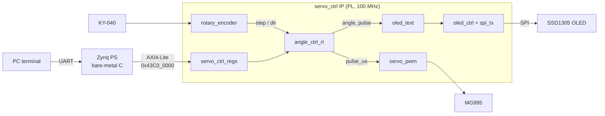

# Zybo Z7-20: Encoder-Controlled Servo with OLED Display

An FPGA project on the Digilent **Zybo Z7-20** (Zynq-7020) that drives an **MG995 servo** from a **KY-040 rotary encoder** and from a serial terminal, and shows the live state on a **128×32 SSD1305 OLED**.

The design goal was to keep all real-time work in programmable logic (PL). The ARM core (PS) only relays terminal commands to memory-mapped registers; if the PS stops, the encoder still drives the servo and the display keeps updating.



## Features

- **Encoder input:** synchronizer, debounce and a Gray-code quadrature decoder that is robust to contact bounce; one `step` pulse per mechanical detent.
- **Servo control:** 0–180° target angle with saturation, runtime-calibratable pulse range (500–2500 µs measured on the real servo), 50 Hz PWM with glitch-free updates (shadow register).
- **Terminal control:** relative (`+30`, `-45`) and absolute (`=90`) moves, step size and calibration commands over UART.
- **OLED display:** SPI driver and SSD1305 init sequence written from scratch; text is rendered **on the fly without a framebuffer** (8×16 font ROM, double-dabble BCD conversion).
- **Verification:** every module has a self-checking testbench; all of them run with one command.

## Hardware

| Part | Connection |
|---|---|
| KY-040 CLK / DT / SW | Pmod JE pin 1 / 2 / 3, + → JE pin 6 (3.3 V), GND → JE pin 5 |
| MG995 signal | Pmod JD pin 1 |
| MG995 power | External 5 V supply (≈1.8 A limit), ground shared with the board |
| OLED DIN / CLK / CS / DC | Pmod JC pin 1 / 2 / 3 / 4 |
| OLED RST | Pmod JC pin 7 |
| OLED VCC / GND | JC pin 6 (3.3 V) / JC pin 5 |
| SW0 | Hardware enable / emergency stop for the servo |

## Register map (`servo_ctrl`, base `0x43C0_0000`)

| Offset | Name | Access | Description | Reset |
|---|---|---|---|---|
| 0x00 | CTRL | R/W | bit0 software enable, bit1 write 1 to center (command) | 1 |
| 0x04 | MOVE | W | Signed relative move in degrees (command) | – |
| 0x08 | ANGLE | R/W | Read current angle / write to go to an absolute angle | 90 |
| 0x0C | STEP_DEG | R/W | Degrees per encoder detent | 5 |
| 0x10 | MIN_US | R/W | Pulse width at 0° | 500 |
| 0x14 | MAX_US | R/W | Pulse width at 180° | 2500 |
| 0x18 | STATUS | R | bit0 at min, bit1 at max, bit2 servo active | – |
| 0x1C | PULSE_US | R | Pulse width currently being sent | – |

The servo only receives pulses when **SW0 is on and CTRL.EN = 1**, so the hardware switch always overrides software.

## Terminal commands (115200 8N1)

| Command | Effect |
|---|---|
| `+30` / `-45` | Relative move |
| `=90` | Absolute angle (0–180) |
| `c` | Center |
| `on` / `off` | Software enable / disable |
| `step 10` | Degrees per encoder detent |
| `min 500` / `max 2500` | Calibration (µs) |
| `?` | Print status |

## Repository layout

```
rtl/           Reusable modules (servo_pwm, rotary_encoder, debounce, angle_ctrl_rt,
               spi_tx, oled_ctrl, oled_text, font_rom, bin2bcd)
ip/servo_ctrl/ AXI4-Lite IP top level and register block
test_tops/     PL-only board tests used during bring-up (125 MHz, no PS)
sim/           Self-checking testbenches
constraints/   XDC files for each board test and for the final system
sw/            Bare-metal terminal application (Vitis)
scripts/       Simulation runner and font ROM generator
```

## Simulation

With [Icarus Verilog](https://github.com/steveicarus/iverilog):

```bash
./scripts/run_sims.sh
```

```
[PASS] tb_servo_pwm
[PASS] tb_rotary_encoder
[PASS] tb_angle_ctrl
[PASS] tb_angle_ctrl_rt
[PASS] tb_spi_tx
[PASS] tb_oled_ctrl
[PASS] tb_oled_text
[PASS] tb_servo_ctrl
------------------------------
PASS: 8   FAIL: 0
```

The same testbenches run in the Vivado simulator (`run all`). Notable ones: `tb_rotary_encoder` drives a randomly bouncing encoder model; `tb_servo_ctrl` emulates the PS with AXI read/write tasks; `tb_oled_text` renders the screen as ASCII art in the console.

## Building (Vivado / Vitis 2025.2)

1. **Package the IP:** *Tools → Create and Package New IP* → AXI4 peripheral, name `servo_ctrl`, 8 registers. Replace the generated top with `ip/servo_ctrl/servo_ctrl.v`, add `ip/servo_ctrl/servo_ctrl_regs.v` and everything in `rtl/`, remove the template register file, then package.
2. **Block design:** new project for the Zybo Z7-20 board → ZYNQ7 Processing System (*Run Block Automation*) → add `servo_ctrl` (*Run Connection Automation*) → make the encoder, servo, LED, SW0 and OLED ports external.
3. **Constraints:** `constraints/system.xdc` (the PL clock comes from the PS, FCLK_CLK0 = 100 MHz).
4. Generate the bitstream and *Export Hardware* (include bitstream).
5. **Vitis:** platform from the `.xsa` (standalone, `ps7_cortexa9_0`), application from the Hello World template, replace the source with `sw/main.c`.

Timing at 100 MHz: WNS ≈ +1.6 ns.

## Design notes

- **Single clock domain.** Slower functions use clock-enable ticks (1 µs, 10 µs) instead of extra clocks; only external inputs cross into the clock domain through 2-FF synchronizers.
- **Bounce-tolerant decoding.** Quadrature transitions are counted as ±1 and a detent is only accepted when the encoder returns to a rest state with the full net count, so bounces cancel out and half turns produce nothing.
- **No divider.** The angle-to-pulse conversion divides by 180 with a fixed-point multiply (`× 2913 >> 19`, error < 1 µs), pipelined to meet timing.
- **Value vs. command registers.** Configuration registers hold their value; command registers (MOVE, ANGLE write, center) generate single-cycle strobes so a command is applied exactly once.
- **Framebuffer-less display.** For each (page, column) the SSD1305 asks for, the text generator picks the character and font column directly; values are snapshotted at the start of each frame to avoid tearing.

## Bring-up lessons

- The "360°" servo turned out to be a 180° position servo; measured its usable range (500–2500 µs) on the bench instead of trusting the datasheet.
- The KY-040 produces half a quadrature cycle per detent, so the decoder is parameterized (`EDGES_PER_DETENT`).
- Several "logic" failures were wiring: a missing common ground, encoder lines on the wrong header. Reading registers back from the PS isolated these quickly.
- After changing hardware, the Vitis platform must be updated, otherwise the old bitstream is loaded.

## License

MIT, see [LICENSE](LICENSE). The font bitmaps in `rtl/font_rom.v` are derived from DejaVu Sans Mono (Bitstream Vera license).
